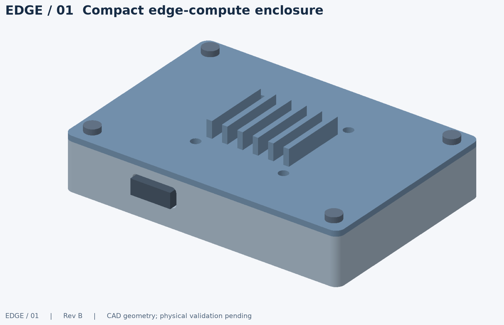
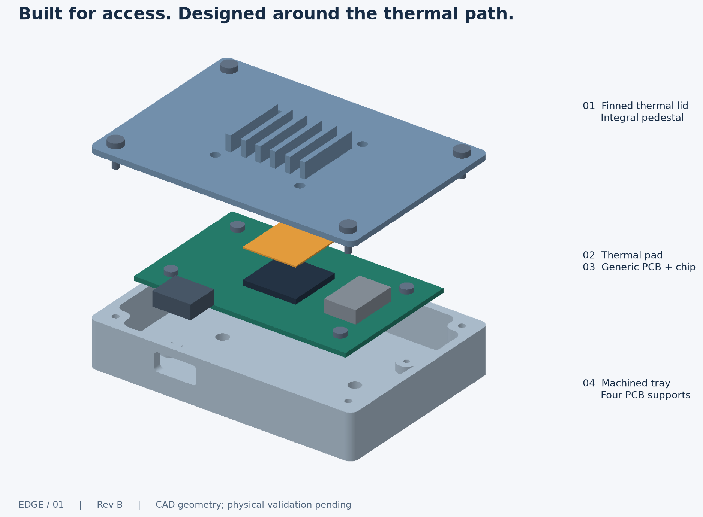
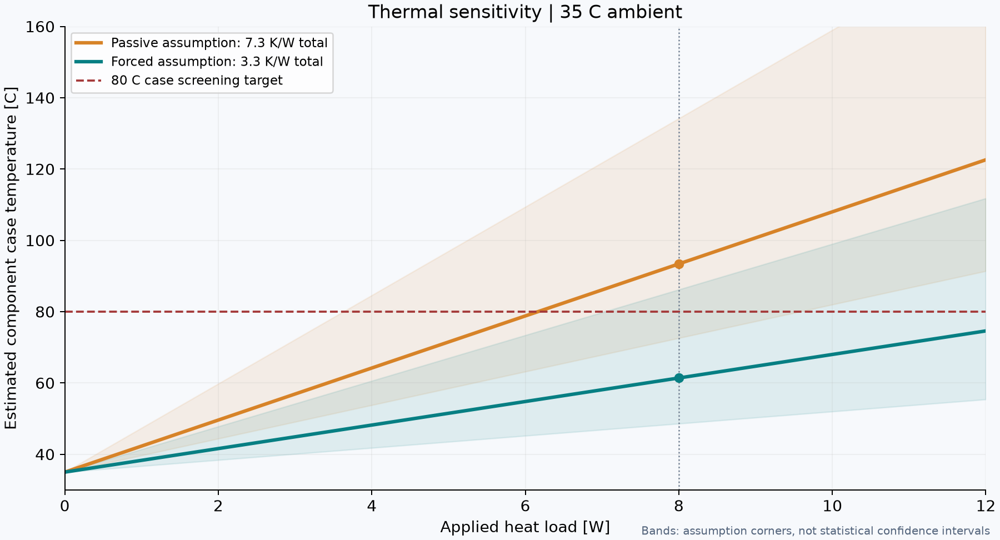

# EDGE / 01 — Compact Edge-Compute Enclosure

[](https://github.com/gokulg846/compact-edge-enclosure/actions/workflows/validate.yml)

**A complete digital prototyping study: editable CAD, manufacturing planning, inspection strategy and executed validation.** Independent work for a hardware prototyping portfolio; not a comma.ai design or replica.



[Engineering report](report/engineering-report.pdf) · [One-page portfolio](report/portfolio-summary.pdf) · [Drawing package](drawings/drawing-package.pdf) · [Assembly STEP](exports/assembly.step) · [Five-minute walkthrough](report/walkthrough.md)

## The engineering result

A 100 × 70 × 25 mm housing packages an assumed 80 × 50 mm PCB. A removable aluminum lid provides an integral chip-to-fin thermal path; a 3-2-1 fixture makes inspection repeatable in principle. The fan variant reaches 35 mm before a 3 mm fastener reserve. Connector and cable clearance are additional to the housing dimensions.

**The passive thermal hypothesis fails:** at assumed 8 W /35°C ambient it predicts 93.4°C case temperature against an 80°C screening target. Forced airflow predicts 61.4°C nominal, but its high-resistance corner also fails. A 0.31–0.69 mm worst-case pad gap exposes the need to select a real compression-force curve before fabrication.

This project demonstrates a reviewable decision process, not a claim of completed machining, printing, measured performance, FEA or CFD. The highest-priority next step is an unpowered fit article followed by a measured metal thermal-path test.

## Start here

| Deliverable | Files |
|---|---|
| Editable solid CAD | [model.py](cad/model.py), [parameter master](cad/parameters.json) |
| OpenSCAD companion | [enclosure.scad](cad/enclosure.scad), [generated include](cad/generated_parameters.scad); supplied but not executed |
| Genuine solid/mesh exports | [exports/](exports/) — component STEP/STL, passive and fan assemblies, two DXF sections |
| Drawings and inspection | [5-sheet PDF](drawings/drawing-package.pdf), [inspection plan](drawings/inspection-plan.md) |
| CNC / printing / parts | [CNC setups](manufacturing/cnc/setup-plan.md), [print plan](manufacturing/printing/print-plan.md), [candidate BOM](manufacturing/bom.md) |
| Analysis / test planning | [thermal model](analysis/thermal.py), [heater protocol](analysis/thermal-validation.md), [concepts/revisions/risks](analysis/design-review.md) |
| Fixture | [design and 20-trial protocol](fixture/README.md), [layout](images/fixture_layout.png) |
| Executed evidence | [validation JSON](results/validation.json), [test output](results/tests.txt), [package checks](results/package-check.json), [environment](results/environment.json) |
| Application assets | [one-page PDF](report/portfolio-summary.pdf), [email draft](report/application-email.txt), [walkthrough](report/walkthrough.md) |
| Full file list / hashes | [inventory](results/file-inventory.txt), [SHA-256 manifest](results/manifest.sha256) |



## Reproduce

Python 3.12 is the tested interpreter. No FreeCAD/OpenSCAD desktop installation is needed for the verified CadQuery pipeline. From the repository root:

```bash
python3.12 -m venv .venv
source .venv/bin/activate
python -m pip install -r requirements.txt
python scripts/rebuild.py
```

The single command regenerates CAD, companion SCAD parameters, exports, thermal results/plot, geometry checks, tests, visuals, all three PDFs, package checks and file hashes. It stops on a failed command. The exact environment used is recorded in `results/environment.json`; dependencies are pinned in `requirements.txt`. macOS ARM64 is locally tested; GitHub Actions runs Linux validation when available. Review every changed PDF visually before issuing a new design revision.

Individual steps:

```bash
python scripts/build.py                         # parametric B-reps, STEP, STL, DXF, CAD SVG
python scripts/scad.py                          # OpenSCAD include from shared parameters
python analysis/thermal.py                     # calculation JSON and sensitivity plot
python scripts/validate.py                     # real geometry and export checks
python -m pytest -q --junitxml=results/tests.xml
python scripts/visuals.py
python scripts/report.py                       # PDFs; requires prior results and images
python scripts/package_check.py                # PDF/DXF/SVG checks and manifest
```

Edit `cad/parameters.json`, then run the full rebuild. Parameter changes must pass validation and be checked against the documented interface tables: release drawings/report are written around the Rev B nominal dimensions and require engineering revision after parameter changes. Supported envelope changes are unit-tested, not every possible configuration. `material` and `process` fields are descriptive; they do not qualify a process or automatically resize holes for printing.

OpenSCAD users: open `cad/enclosure.scad` after regenerating its include. Set `part` to `base`, `lid`, `pcb`, `fixture`, `assembly` or `exploded`. Its fixture companion contains the plate/buttons only. OpenSCAD was unavailable, so only the CadQuery path and its exports are validated. STEP is B-rep solid exchange, never a renamed STL. DXF files are CAD sections, not production toolpaths.

## Actual verification and limits

See the current machine-generated results for authoritative counts. The release checks individual B-reps, STEP reimport validity/volume, STL watertightness/winding/volume, assembly solid counts, nominal component intersections, parameter boundaries, thermal arithmetic and report integrity. No broad claim of manufacturing or strength validation follows from those checks.



Three major open risks: effective cooling under real flow/orientation; thermal-pad pressure and PCB strain; thin-lid distortion and actual CNC tool/fixture access. Other open items include actual board dimensions, hardware/lead selection, blind tapping, printer compensation, clamp hardware and physical fixture repeatability. CNC plans are review artifacts; no CAM simulation, G-code or machine prove-out is represented as complete.

**Physical validation sequence:** measure/select interfaces → print fit article/coupons → inspect and run fixture reinstall trials → generate/simulate actual CAM → machine and inspect metal parts → validate pad contact → guarded heater tests. Empty raw-log templates are deliberately empty. The repeatability analyzer refuses to treat missing measurements as a pass.

[Requirements](requirements.md) · [Assumptions and coordinate system](assumptions.md) · [Public context sources](report/sources.md)
