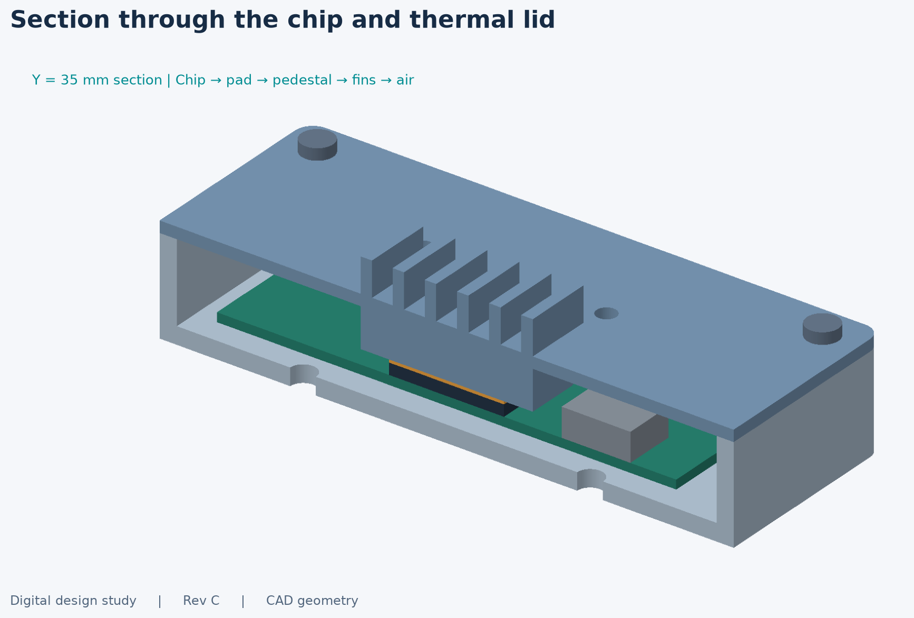
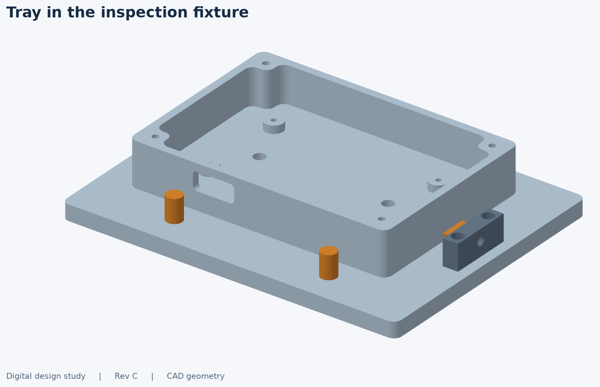

# What this project is

We designed a small metal box for a generic electronics board. The box needs to protect and support the board, leave room for connectors, come apart for servicing, and remove heat from one hot component.

This is a digital mechanical-design exercise. You do not need to pretend you built or tested a physical unit to explain its value.

## 1. Understand the four layers

Read the picture from the bottom up:

**The tray** is the lower metal box. Four short supports hold the circuit board above its floor. Four thicker corner regions receive the cover screws. There is an opening for a connector in the front wall. Two holes through the floor provide an external mounting interface.

**The circuit board** is the green rectangle. It is an assumed 80 × 50 mm board, not a purchased computer. The dark square represents a hot chip; the gray block reserves space for other components. These simple shapes let us investigate packaging without pretending to know a real board's layout.

**The thermal pad** is the orange layer. It fills the small gap between the chip and the metal lid. It must make contact, but pressing it too hard could bend the board. That is why its gap and compression matter.

**The thermal lid** is the upper metal part. Its underside has a raised block reaching toward the chip. Its outside has six fins. Heat is intended to pass from the chip through the pad into the lid and then to the surrounding air. Four screws allow the lid to be removed.

The picture is generated from the actual CAD geometry. It is not a photograph or a simulated temperature field.

## 2. Why these dimensions?

The 100 × 70 × 25 mm enclosure and 80 × 50 mm board are starting assumptions. They were not measured from comma.ai hardware. Their purpose is to make the exercise specific enough to calculate and review.

The 25 mm total height contains a 17 mm tray, a 2 mm lid plate and 6 mm external fins. The board sits at 6 mm above the bottom. That leaves space for floor mounting hardware and a defined thermal contact stack.

A generic optional fan sits above the fins. It increases the modeled height to 35 mm, with additional space reserved for fastener heads. It is an alternative configuration, not something hidden inside the 25 mm claim.

## 3. What was actually done?

| Work | What exists | What it establishes |
|---|---|---|
| Mechanical design | Editable CAD and separate parts | Real geometric shapes with holes, pockets, supports and a removable lid |
| Packaging checks | Solid-intersection and clearance checks | Nominally modeled parts do not occupy the same space |
| Export checks | STEP files reopened and compared; STL meshes inspected | Downloaded geometry is usable as geometry, rather than merely an illustration |
| Tolerance analysis | A worst-case pad-gap calculation | How dimensional errors could affect contact |
| Thermal analysis | Resistance sensitivity and an area-based comparison | Which cooling assumptions must be true for the design to meet its screening target |
| Design comparison | Four fin candidates, with valid ones actually rebuilt | Which alternatives conflict with the height and cutter constraints |
| Manufacturing planning | Stock, setups, tools, holding and inspection notes | A process an engineer or machinist can review; not verified CAM |
| Fixture concept | Six contacts and two lateral clamp pads | A proposed repeatable locating method; no measured repeatability |

A unit test is a check on the software/calculation. An interference check is a check on geometry. Neither is a vibration test, a machining result or a measurement of a real enclosure.

## 4. The two important engineering findings

### Finding A: heat removal is unresolved

The first calculation uses the relationship `temperature rise = heat × thermal resistance`. At an assumed 8 W and 35°C ambient, one passive resistance scenario gives 93.4°C at the component case. A lower-resistance fan scenario gives 61.4°C.

Those numbers are conditional: **the project has not demonstrated that this lid actually achieves either resistance**. The newer area analysis makes that uncertainty more concrete. It calculates exposed lid/fin area and asks how much heat transfer per unit area would be needed to stay under 80°C.

Read [the design comparison](analysis/design-study.md). Do not describe the fan case as “validated cooling,” and do not call these calculations CFD.

### Finding B: a small gap can be a large design problem

The nominal distance between chip and lid contact is 0.50 mm. Adding the proposed dimensional tolerances in the worst direction gives a possible gap of 0.31–0.69 mm.

A nominal 1 mm soft pad would therefore experience a wide range of compression. The calculation identifies a real design decision: choose a pad with a suitable pressure/compression curve, or revise the contact height. It does not prove an unspecified pad will work.

## 5. What is the separate fixture for?

A fixture is tooling that holds another part consistently. Three bottom contacts set its height and prevent rocking; two front contacts set its front position and rotation; one side contact sets its remaining horizontal position. Gentle clamps push the tray against those references.

This is often called **3-2-1 location**. The fixture is an inspection/assembly concept. It is not a clamp qualified for CNC cutting forces, and its repeatability has not been measured.

## 6. Which files should you open?

- To understand the project: this page, then [the design comparison](analysis/design-study.md).
- To show a reviewer: [engineering report](report/engineering-report.pdf) or [one-page summary](report/portfolio-summary.pdf).
- To inspect or import the complete enclosure in CAD: [assembly.step](exports/assembly.step).
- To inspect the two custom enclosure parts: [base.step](exports/base.step) and [thermal_lid.step](exports/thermal_lid.step).
- To inspect the separate fixture: [fixture_assembly.step](exports/fixture_assembly.step).
- To change dimensions: [parameters.json](cad/parameters.json), then rebuild. The source model is [model.py](cad/model.py).

The `exports/components` and `exports/meshes` directories contain supporting generated files. They are not additional projects, and you do not need to read each file. The original repository looked much larger than the actual design because every screw and locator was exported separately.

## 7. Explain it in 45 seconds

> This is a digital mechanical-design study of a compact electronics enclosure. The main design choice is using the removable aluminum lid as the heat sink, with an underside contact block and external fins. I developed the packaging, checked nominal geometric fit, calculated the thermal-pad tolerance stack, and compared fin alternatives against size and machining constraints. The analysis identifies two open decisions: whether the available cooling is sufficient and how to control pad pressure. The repository includes editable CAD and a manufacturing review package. It has not been physically built or thermally validated.

Use that explanation only after you can point to each feature and reproduce the two calculations. The work was developed with AI assistance; the point of this guide is to make the assumptions and decisions inspectable, not to disguise how the files were produced.

## Terms you will encounter

| Term | Meaning here |
|---|---|
| PCB | Printed circuit board; represented by the green plate |
| Pedestal | The raised metal contact block on the underside of the lid |
| Thermal resistance | Temperature rise per watt of heat along a specified path |
| Datum | A reference surface used to locate measurements |
| Tolerance stack | Combined variation from several dimensions in one functional gap |
| STEP | A solid-geometry exchange file a CAD application can import |
| STL | A triangulated surface file, commonly used for printing |
| Parametric CAD | Geometry regenerated from editable dimensions and rules |
| CAM | Programming/simulation of machine operations; not completed in this project |
