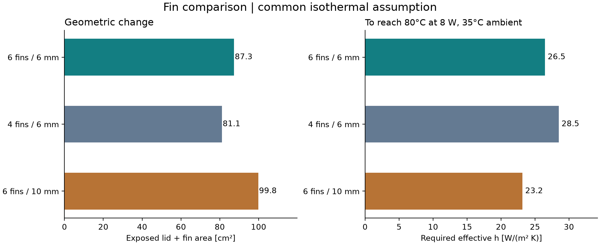

# Fin design comparison

The first release assigned thermal resistances to passive and fan scenarios. That answered “what happens if these resistances are achieved?” It did not establish whether the geometry could achieve them.

This revision adds two checks: actually rebuild a few fin alternatives, and calculate how much heat transfer their exposed area would require.

## The candidates

The tray, board, thermal pad and lid contact remain unchanged. Only fin count/height changes. The taller candidate increases total housing height so it does not steal internal board clearance.

| Candidate | Housing height | Fin channel | Exposed lid + fin area | Result |
|---|---:|---:|---:|---|
| Six fins, 6 mm high | 25 mm | 3.60 mm | 87.33 cm² | Retained baseline |
| Four fins, 6 mm high | 25 mm | 7.33 mm | 81.09 cm² | Rebuilt successfully; less area, wider channels |
| Six fins, 10 mm high | 29 mm | 3.60 mm | 99.81 cm² | Rebuilt successfully; exceeds height target |
| Eight fins, 6 mm high | 25 mm | 2.00 mm | Not evaluated | Rejected before CAD build: channel below the chosen 3 mm cutter constraint |

The three valid candidates each undergo 105 nominal solid-pair overlap checks. They are CAD comparisons, not fabricated revisions. The compared lids are available as [six short fins](../exports/studies/six_fins_6mm.step), [four short fins](../exports/studies/four_fins_6mm.step) and [six tall fins](../exports/studies/six_fins_10mm.step). Each STEP file is reimported and checked. Raw results and changed parameters are in [design-study.json](../results/design-study.json); the shorter table is in [design-study.csv](../results/design-study.csv).



## How the area calculation works

Begin with the rounded 100 × 70 mm lid plan area. Subtract holes and the area covered by the four lid screw heads. Fins cover some of the original top face, but their own top faces replace that footprint. The new exposed area therefore comes from their two long sides and two ends:

```text
A = rounded lid plan - holes - screw-head coverage
    + 2 × number of fins × fin height × (fin length + fin thickness)
```

Convert mm² to m² before using heat-transfer units. For the baseline, A = 0.008733 m².

This counts only the upper lid and fins. It excludes the tray, lid edges, screw-head heat loss, PCB paths and radiation. It also assumes the entire counted area is at one temperature. Real fins have temperature gradients and different local airflow. Consequently this is an optimistic area comparison for the isolated lid path at a specified convection coefficient, not a rigorous bound on the complete device.

## What the original resistance assumption implies

With a uniform effective heat-transfer coefficient h:

```text
R_air = 1 / (h × A)
```

On the baseline area, the original passive R_air = 6 K/W corresponds to h ≈ 19.1 W/(m² K); the original fan R_air = 2 K/W corresponds to h ≈ 57.3 W/(m² K). Neither coefficient has been demonstrated for this geometry. These are implied requirements, not values taken from a selected fan or a validated natural-convection correlation. The earlier effective-resistance scenarios could also contain paths omitted by this area model, so they are not interchangeable physical predictions.

At 8 W and 35°C ambient, the 80°C case target permits a total resistance of (80−35)/8 = 5.625 K/W. Subtract the assumed pad/contact and spreading terms, 0.8 + 0.5 = 1.3 K/W. That leaves 4.325 K/W for the air path.

The corresponding required h is:

| Candidate | Required effective h to meet the screening target |
|---|---:|
| Six fins, 6 mm high | 26.48 W/(m² K) |
| Four fins, 6 mm high | 28.51 W/(m² K) |
| Six fins, 10 mm high | 23.17 W/(m² K) |

A lower required h means less demanding heat transfer under the common assumptions. It does not demonstrate actual fan flow or natural convection. The wider four-fin channels might allow different airflow; this simple area model does not capture that effect and cannot rank their real thermal performance definitively.

## Decision

Keep the six-fin, 25 mm housing as the comparison baseline. Four fins make machining access easier but provide less area. Taller fins add about 14% exposed area while increasing housing height by 4 mm. Eight fins conflict with the chosen tool constraint. Changing to a smaller tool is possible in principle, but would require revisiting tool reach, deflection and the manufacturing plan.

**No candidate closes the cooling question digitally with the evidence available.** The stronger conclusion is that the required heat transfer is now quantified and tied to geometry. A next digital extension would use a selected fan curve and a declared airflow model, or a documented CFD setup with mesh/convergence checks. Neither has been fabricated for this release.

Reproduce with `python analysis/design_study.py`. Inputs live in `cad/parameters.json` and `analysis/assumptions.json`.
